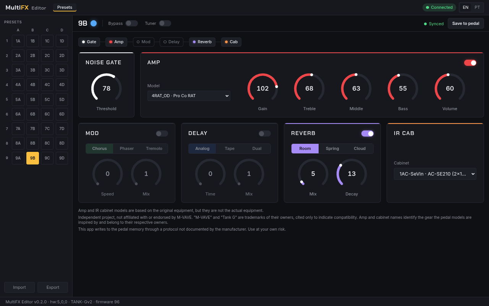

# MultiFX Editor

Linux desktop editor for the M-VAVE Tank G multi-effects pedal. Unofficial.

[Leia em português](README.pt-BR.md)



> [!NOTE]
> Independent project, not affiliated with or endorsed by M-VAVE. "M-VAVE" and "Tank G" are trademarks of their owners, cited only to indicate compatibility. Amp and cabinet names identify the gear the pedal models are inspired by and belong to their respective owners.

> [!WARNING]
> This app writes to the pedal memory through a protocol not documented by the manufacturer. Use at your own risk. Back up your presets with the official app before using it. There is no warranty, and using it may void the manufacturer's warranty.

## Features

- 36 presets in 9 banks (A/B/C/D slots), loaded from and saved to the pedal
- Editing of the AMP, MOD, Delay, Reverb, IR Cab and Noise Gate modules
- LED color picker
- Preset import and export as JSON
- Tuner and bypass controlled from the app
- Two-way sync with the pedal
- English and Brazilian Portuguese interface

A diagnostic command line tool is also included: `scripts/multifx-cli.mjs`.

## Requirements

- Linux
- `alsa-utils` (provides `amidi`)
- Your user in the `audio` group, or run `sudo bash scripts/setup-udev.sh` to install the udev rules
- The pedal connected by USB

## Install

Download the AppImage from the [releases page](https://github.com/rmsramos/multifx-editor/releases), then:

```bash
chmod +x MultiFX-Editor-*.AppImage
./MultiFX-Editor-*.AppImage
```

## Build from source

```bash
npm install
npm run dev          # development (Electron + Vite)
npm run build:linux  # AppImage into release/
npm test             # test suite
```

## Protocol documentation

- [USB SysEx protocol](docs/protocol/usb-sysex.md)
- [USB SysEx: block write used by M-EFCS 3.10](docs/protocol/usb-sysex-mefcs-310.md)
- [Firmware update (OTA)](docs/protocol/ota-firmware.md)

The protocol was obtained by observing the MIDI traffic between the official app and the pedal, for interoperability purposes. We understand this kind of analysis to be permitted under Brazilian Law 9.609/98 art. 6 IV, EU Directive 2009/24/EC art. 6 and US DMCA §1201(f). No content from the official app, firmware or manual is reproduced in this repository. This is not legal advice.

## Contributing

Issues and pull requests are welcome. Changes must come with tests, and `npm test` must pass.

## License

[GPL-3.0-only](LICENSE)
